# 1. En-tête
Intitulé du TD : TD stockage de matrices en C.
| Prénom NOM                | Identifiant GitHub |  
|            ---            |         ---        |
| Ninon LE PARQUIC--SANTAIS | ninonlps           |
| Elisa SIEGEL              | elisasiegel        |
| Jérôme DUBOCQ             | jerdub45           |

Groupe TD : TD3

Date de rendu :

## Table des matières :

1. [En-tête](#1-en-tête)
2. [Introduction](#2-introduction)
3. [Conception](#3-conception)
4. [Réalisation](#4-réalisation)
  * [Exercice 1](#exercice-1)
  * [Exercice 2](#exercice-2)
  * [Exercice 3](#exercice-3)
  * [Exercice 4](#exercice-4)
5. [Vérification mémoire](#5-vérification-mémoire)
6. [Démonstration finale](#6-démonstration-finale)
7. [Bilan et difficultés](#7-bilan-et-dificultés)

# 2. Introduction
Ce projet est réalisé dans le cadre du cours de programmation C. Il s'agit d'une bibliothèque C ayant pour but la manipulation de matrices de coefficients entiers et les calculs matriciels associés. Cette bibliothèque se découpe en plusieurs modules qui possèdent chacun une utilité qui leur est propre. Les objectifs de ce TD sont :

* Bien faire la différence entre le contrat (.h) et l'implémentation (.c)
* Apprendre à compiler différents modules séparéments
* Apprendre à manipuler correctement la mémoire
* Apprendre à gérer les erreurs et mettre en place des tests
* Apprendre à lire et écrire des données dans un fichier texte

# 3. Conception

# 4. Réalisation
## Exercice 1
### Question (1.a)
```c
  /* (1.a) */
  case MAT_ERR_DIMENSIONS:  return "dimensions incompatibles";
  case MAT_ERR_DEPASSEMENT: return "résultat hors de l'intervalle des int";
  /* (fin 1.a) */
```
Vérification :


### Question (1.b)
```c
  /* (1.b) */
  return m != NULL
    && m->coef != NULL
    && m->nb_lignes >= 1 && m->nb_lignes <= MAT_DIM_MAX
    && m->nb_colonnes >= 1 && m->nb_colonnes <= MAT_DIM_MAX;
  /* (fin 1.b) */
```
Vérification :


### Question (1.c)
```c
  /* (1.c) si nb_lignes ou nb_colonnes n'est pas compris
   *       entre 1 et MAT_DIM_MAX, renvoyer MAT_ERR_ARGUMENT.          */
  if ( (nb_lignes < 1 || nb_lignes > MAT_DIM_MAX)
    || (nb_colonnes < 1 || nb_colonnes > MAT_DIM_MAX) )
  {
    return MAT_ERR_ARGUMENT;
  }
  /* fin (1.c) */
```
Vérification :


### Question (1.d)
```c
    /* (1.d) */
    for (int i = 0; i < nb_lignes; i++) {
        coef[i] = mat_calloc(nb_colonnes, sizeof(int));     // chaque ligne contient nb_collonnes entiers
        if (coef[i] == NULL) {                  // si une ligne est NULL, 
            for (int k = i - 1; k >= 0; k--)    // on libère toutes les lignes précédentes
                free(coef[k]);                  
            free(coef);                         // et le tableau de pointeurs
            return MAT_ERR_ALLOCATION;
        }
    }
```
En cas d'échec il faut rendre non seulement toutes les lignes précédemment allouées mais aussi le tableau coef lui-même.


Compilation/test :


On remarque que l'échec d'allocation simulé à bien fonctionné mais que la vérification que les coefficients sont nuls a échouée. Dans un premier temps il nous a semblé qu'un oubli de notre part avait dû être commis mais après réflexion nous pensons que c'est parce qu'à ce stade la structure *res n'est pas encore mise à jour avec les pointeurs fraichement alloués. Cela se vérifiera à la question suivante.

### Question (1.e)
```c
  /* (1.e) : maintenant que tout a réussi, remplir *res */
  res->coef = coef;
  res->nb_lignes = nb_lignes;
  res->nb_colonnes = nb_colonnes;
  return MAT_OK;
  /* fin (1.e) */
```
Vérification :

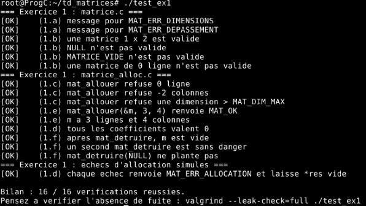

En effet, il suffisait d'attendre la question suivante pour pouvoir faire la vérification.

### Question (1.f)
```c
    /* (1.f) : si m->coef n'est pas NULL alors tout libérer */
    if (m->coef != NULL) {
        for (int i = 0; i < m->nb_lignes; i++) {
            free(m->coef[i]);  // libérer chaque ligne
        }
        free(m->coef);         // libérer le tableau de pointeurs lui-même
    }
    /* fin (1.f) */
```
Vérification :

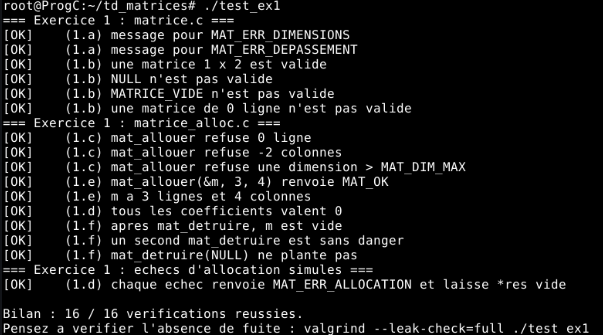

Valgrind :

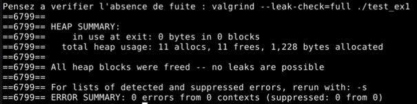

Valgrind nous indique bien : `All heap blocks were freed – no leaks are possible` comme attendu pour valider.
## Exercice 2
### Question (2.a)
```c
    for (int i=0;i<(m->nb_lignes);i++){
      for (int j=0;j<(m->nb_colonnes);j++){
        printf("%8d", m->coef[i][j]);
      }
      putchar('\n');
    }
```
pour compiler le programme j'ai utilisé le modèle des commendes utilisée en td
on test la compilation et le fonctionnement du programme avec test_ex2 :
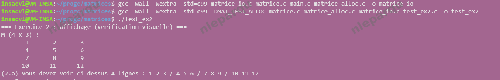
on observe le résultat attendu
### Question (2.b)
```c
    for (int i = 0; i < m->nb_lignes; i++){
      for (int j = 0; j < m->nb_colonnes; j++)
        if( fprintf(f, j==0 ? "%d" : " %d", m->coef[i][j]) < 0)
          return MAT_ERR_ECRITURE;
      if(fputc('\n', f)==EOF)
        return MAT_ERR_ECRITURE;
```
on test la compilation et le fonctionnement du programme avec test_ex2
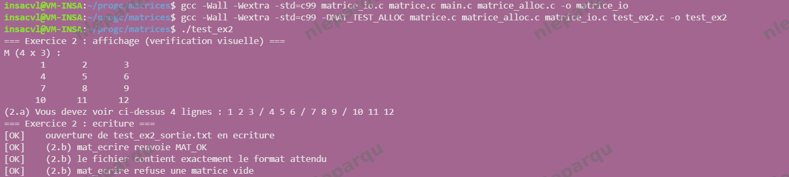
on regarde le contenu de test_ex2_sortie.txt

on observe les résultats attendus 
### Question (2.c)
```c
    if (nb_lignes<1 || nb_lignes>MAT_DIM_MAX || nb_colonnes<1 || nb_colonnes>MAT_DIM_MAX)
      return MAT_ERR_FORMAT;
```
### Question (2.d)
```c
    Matrice tmp;
    err = mat_allouer(&tmp, nb_lignes, nb_colonnes);
    if (err !=MAT_OK)
      return err;
```
### Question (2.e)
```c
    for (int i=0; i < tmp.nb_lignes; i++){
      for (int j=0; j < tmp.nb_colonnes; j++){
        err=lire_entier(f, &tmp.coef[i][j]);
        if (err!=MAT_OK){
          mat_detruire(&tmp);
          return err;
        }
      }
```
### Question (2.f)
```c
    *res=tmp;
    return MAT_OK;
```
on test la compilation et le fonctionnement du programme avec test_ex2 :
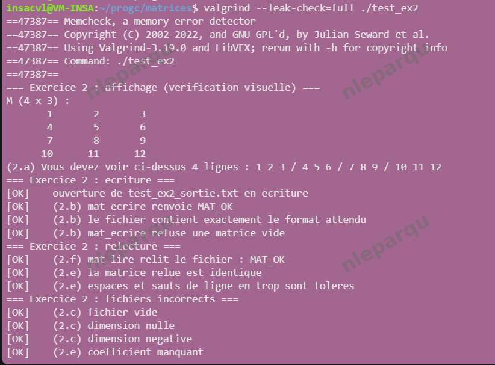
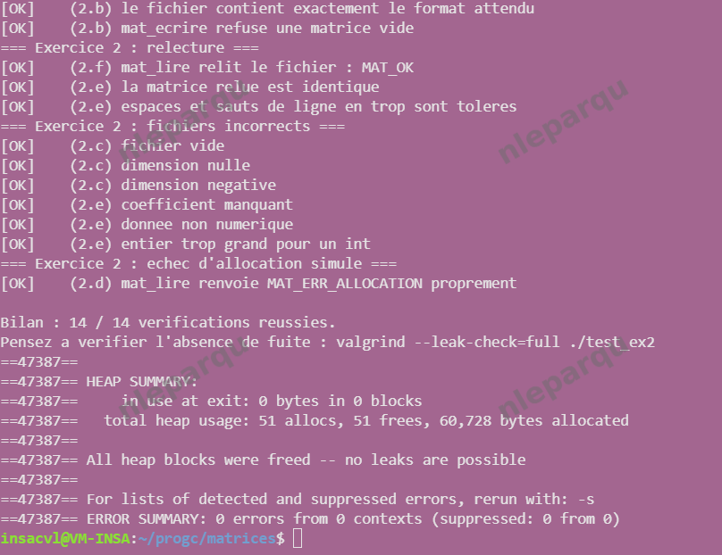
on observe le résultat attendu
### Questions de réflexion
#### question 4.1
mat_lire utilise une matrice temporaire pour simplifier la gestion des erreurs. En effet, si la fonction rencontre un problème, il est plus simple de libérer l’espace mémoire utilisé pour une matrice temporaire et de renvoyer un message d’erreur. 
De plus, renvoyer une matrice qui provoque des erreurs pourrait provoquer des problèmes dans la suite du programme. Pour éviter cela, *res n’est modifié qu’à la fin du programme une fois que les erreurs ont été détectées.
#### question 4.2
Non, la lecture ne vérifie pas que chaque ligne de la matrice soit sur sa propre ligne de texte. Cela n’est pas gênant car le programme ne cherche pas les informations dans la mise en page. Cela correspond avec le principe « tolérant en lecture, strict en écriture », le programme renvoie toujours le même format, mais ne renvoie pas d’erreur si les matrices passées en paramètre ne suivent pas la même mise en page.
#### question 4.3
Le flux est positionné après le dernier coefficient, si on essaye de lire un autre élément dans ce fichier, la lecture commencera après le dernier coefficient lu. De plus, il n’y a pas de problème à avoir plusieurs matrices dans le même fichier comme chaque matrice commence par donner ses dimensions donc le programme sait combien de lignes lire.
#### question 4.4
mat_ecrire appelle fflush car cette fonction utilise fprintf et fputc qui écrivent dans un tampon et certaines erreurs ne peuvent apparaître que lorsque le tampon est vidé, il faut donc utiliser fflush pour le vider. Cela ne dispense pas l’appelant de tester fclose d’une part pour libérer la mémoire (mat_ecrire ne le fait pas) et d’autre part car fclose peut échouer même si fflush réussit puisqu’il y a des erreurs qui ne sont visibles qu’à la fermeture du fichier.
## Exercice 3
### Question (3.a)


### Question (3.b)


### Question (3.c)


### Question (3.d)


Vérification :


### Question (3.e)


### Question (3.f)


### Question (3.g)


### Question (3.h)


Vérification:


Valgrind:


Valgrind nous indique bien : `All heap blocks were freed – no leaks are possible` comme attendu pour valider.

## Exercice 4
### Question (4.a)
```c
    mat_afficher("A",&a);
    mat_afficher("B",&b);
```
### Question (4.b)
```c
    MatErreur err=addition ? mat_additionner(&a, &b, &r) : mat_multiplier(&a, &b, &r);
    if (err != MAT_OK) {
      fprintf(stderr, "Erreur : calcul impossible : %s ", mat_message_erreur(err));
      fprintf(stderr, "(A : %d x %d, B : %d x %d)\n", a.nb_lignes, a.nb_colonnes, b.nb_lignes, b.nb_colonnes);
      goto nettoyage;
    }
```
### Question (4.c)
```c
    mat_afficher(addition ? "R = A + B" : "R = A x B", &r);
```
### Question (4.d)
```c
    printf("Résultat enregistré dans \"%s\".\n", argv[4]);
    statut =EXIT_SUCCESS;
```
### Scénarios de test
#### Scénario 1
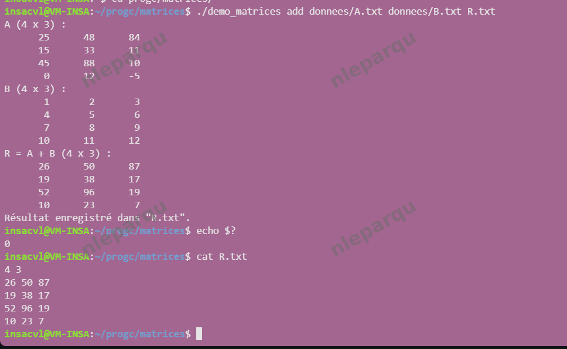
on retrouve les résultats attendus
#### Scénario 2
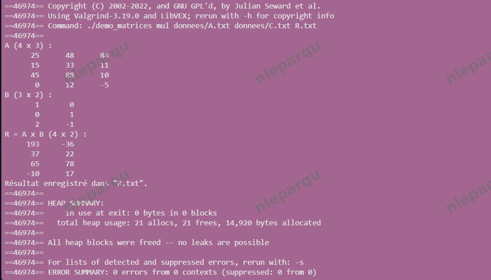
on retrouve les résultats attendus
#### Scénario 3
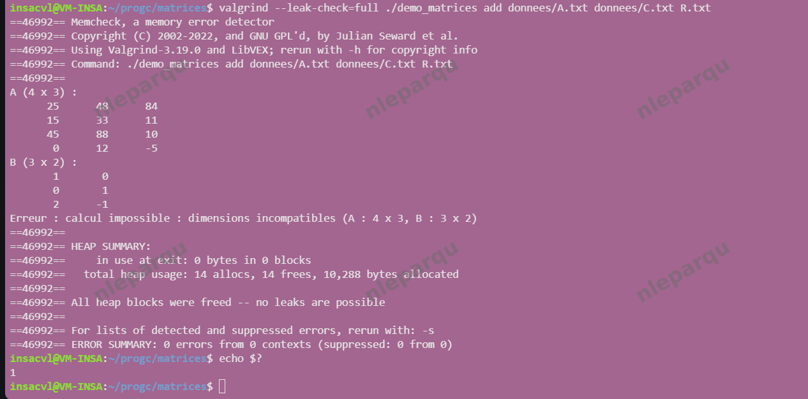
on retrouve les résultats attendus
#### Scénario 4
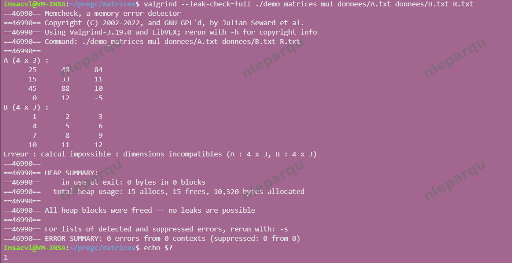
on retrouve les résultats attendus
#### Scénario 5
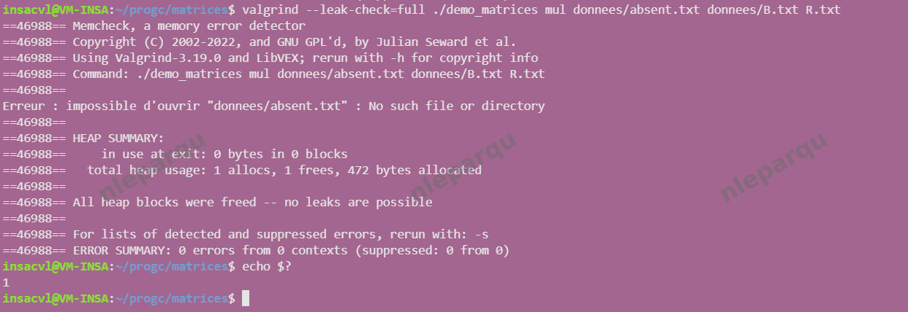
on retrouve les résultats attendus
#### Scénario 6
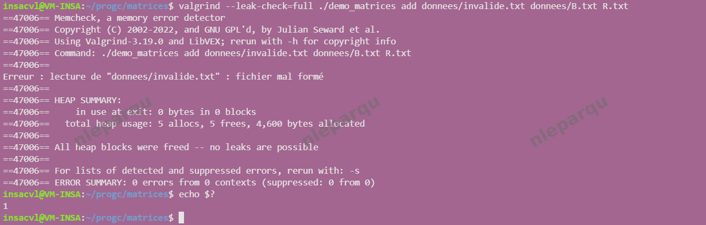
on retrouve les résultats attendus
#### Scénario 7
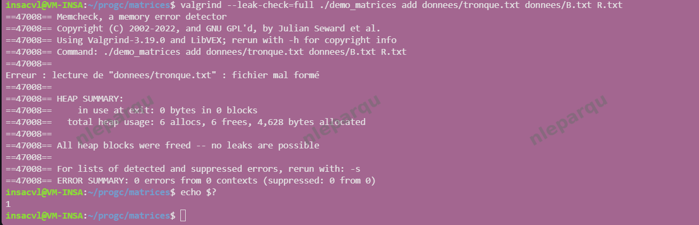
on retrouve les résultats attendus
#### Scénario 8
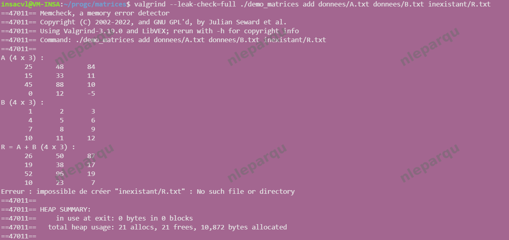
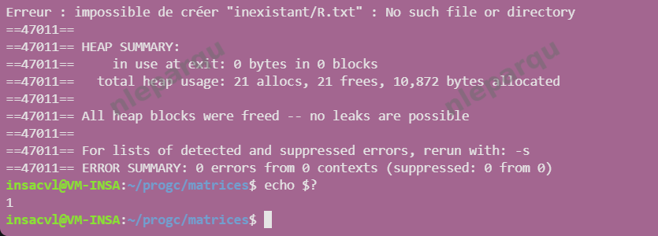
on retrouve les résultats attendus
#### Scénario 9
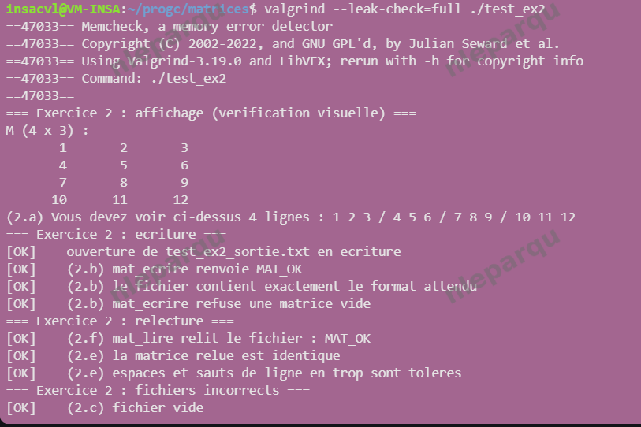
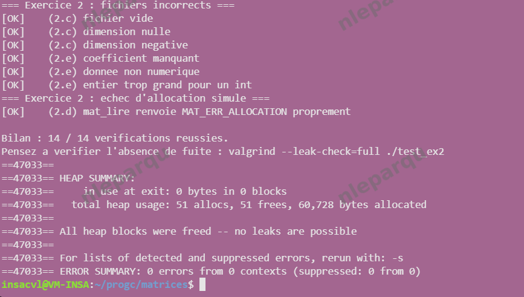
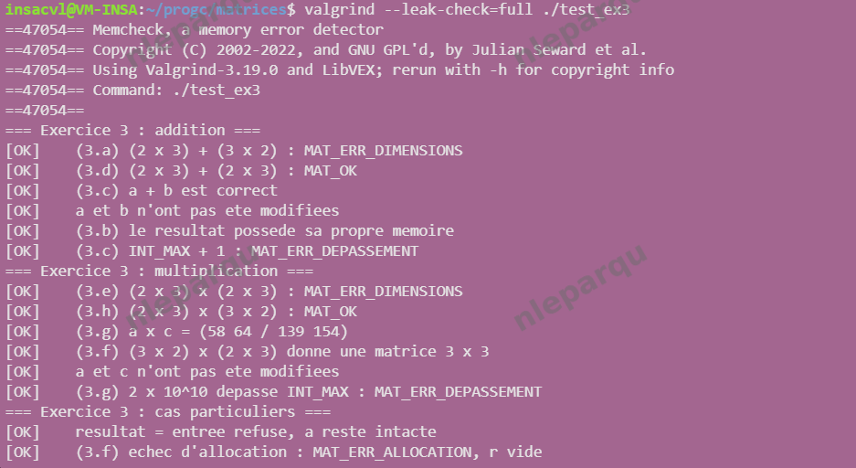
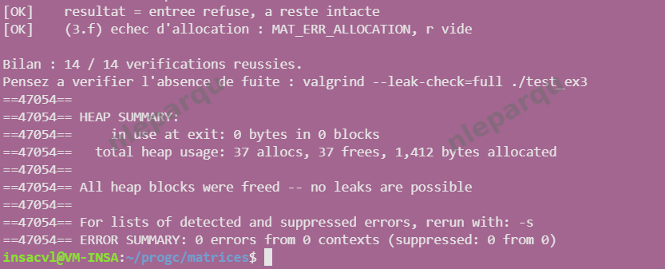
on retrouve les résultats attendus
#### Scénario 10
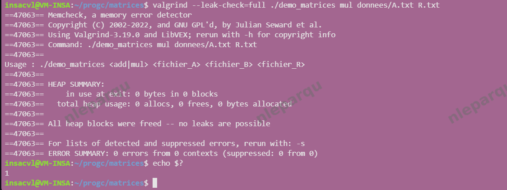
on retrouve les résultats attendus


# 5. Vérification mémoire

# 6. Démonstration finale

# 7. Bilan et difficultés
