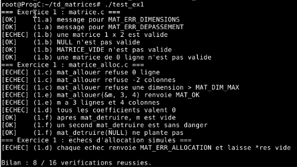
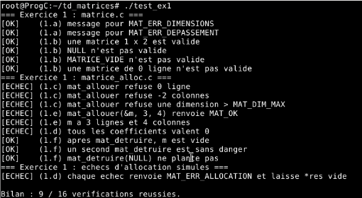
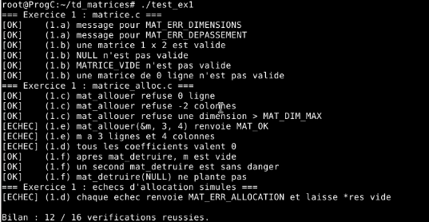
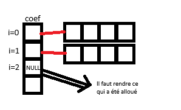
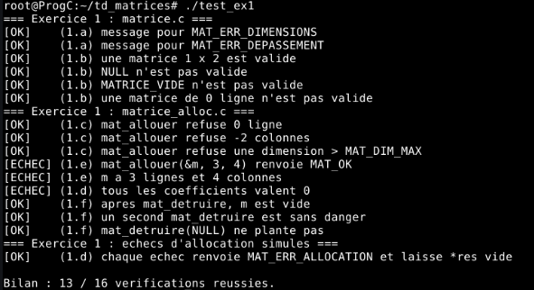

# 1. En-tête
Intitulé du TD : TD stockage de matrices en C.
| Prénom NOM                | Identifiant GitHub |  
|            ---            |         ---        |
| Ninon LE PARQUIC--SANTAIS |                    |
| Elisa SIEGEL              |                    |
| Jérôme DUBOCQ             | jerdub45           |

Groupe TD : TD3

Date de rendu :

# 2. Introduction

# 3. Conception

# 4. Réalisation
## Exercice 1
### Question (1.a)
```c
  /* (1.a) */
  case MAT_ERR_DIMENSIONS:  return "dimensions incompatibles";
  case MAT_ERR_DEPASSEMENT: return "résultat hors de l'intervalle des int";
  /* (fin 1.a) */
```
Vérification :



### Question (1.b)
```c
  /* (1.b) */
  return m != NULL
    && m->coef != NULL
    && m->nb_lignes >= 1 && m->nb_lignes <= MAT_DIM_MAX
    && m->nb_colonnes >= 1 && m->nb_colonnes <= MAT_DIM_MAX;
  /* (fin 1.b) */
```
Vérification :



### Question (1.c)
```c
  /* (1.c) si nb_lignes ou nb_colonnes n'est pas compris
   *       entre 1 et MAT_DIM_MAX, renvoyer MAT_ERR_ARGUMENT.          */
  if ( (nb_lignes < 1 || nb_lignes > MAT_DIM_MAX)
    || (nb_colonnes < 1 || nb_colonnes > MAT_DIM_MAX) )
  {
    return MAT_ERR_ARGUMENT;
  }
  /* fin (1.c) */
```
Vérification :



### Question (1.d)
```c
    /* (1.d) */
    for (int i = 0; i < nb_lignes; i++) {
        coef[i] = mat_calloc(nb_colonnes, sizeof(int));     // chaque ligne contient nb_collonnes entiers
        if (coef[i] == NULL) {                  // si une ligne est NULL, 
            for (int k = i - 1; k >= 0; k--)    // on libère toutes les lignes précédentes
                free(coef[k]);                  
            free(coef);                         // et le tableau de pointeurs
            return MAT_ERR_ALLOCATION;
        }
    }
```
En cas d'échec il faut rendre non seulement toutes les lignes précédemment allouées mais aussi le tableau coef lui-même.



Compilation/test :



On remarque que l'échec d'allocation simulé à bien fonctionné mais que la vérification que les coefficients sont nuls a échouée. Dans un premier temps il nous a semblé qu'un oubli de notre part avait dû être commis mais après réflexion nous pensons que c'est parce qu'à ce stade la structure *res n'est pas encore mise à jour avec les pointeurs fraichement alloués. Cela se vérifiera à la question suivante.

# 5. Vérification mémoire

# 6. Démonstration finale

# 7. Bilan et difficultés
