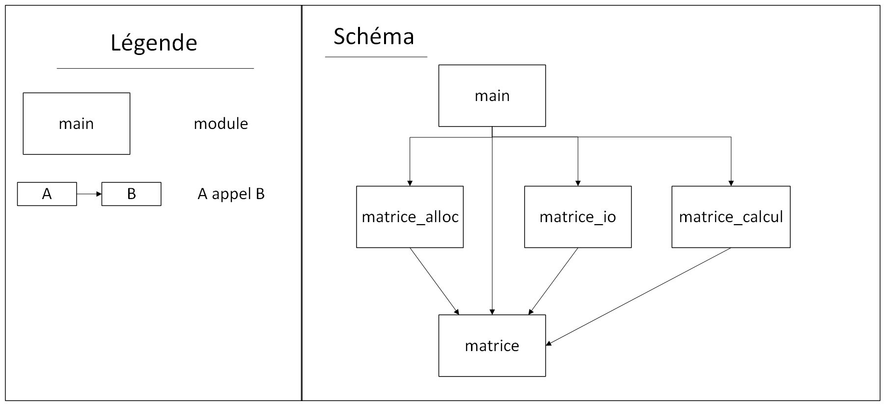
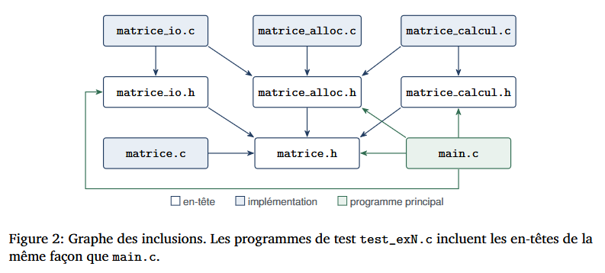

# 1. En-tête
Intitulé du TD : TD stockage de matrices en C.
| Prénom NOM                | Identifiant GitHub |  
|            ---            |         ---        |
| Ninon LE PARQUIC--SANTAIS | ninonlps           |
| Elisa SIEGEL              | elisasiegel        |
| Jérôme DUBOCQ             | jerdub45           |

Groupe TD : TD3

Date de rendu :

## Table des matières :

1. [En-tête](#1-en-tête)
2. [Introduction](#2-introduction)
3. [Conception](#3-conception)
    * [Schéma des modules](#schéma-des-modules)
    * [Graphe des inclusions](#graphe-des-inclusions)
    * [Règles de propriétés de la mémoire](#règles-de-propriétés-de-la-mémoire)
    * [Commande de compilation](#commande-de-compilation)
4. [Réalisation](#4-réalisation)
    * [Exercice 1](#exercice-1)
    * [Exercice 2](#exercice-2)
    * [Exercice 3](#exercice-3)
    * [Exercice 4](#exercice-4)
5. [Vérification mémoire](#5-vérification-mémoire)
6. [Démonstration finale](#6-démonstration-finale)
7. [Bilan et difficultés](#7-bilan-et-dificultés)
    * [Répartition du travail](#répartition-du-travail)
    * [Aides extérieures](#aides-extérieures)

# 2. Introduction
Ce projet est réalisé dans le cadre du cours de programmation C. Il s'agit d'une bibliothèque C ayant pour but la manipulation de matrices de coefficients entiers et les calculs matriciels associés. Cette bibliothèque se découpe en plusieurs modules qui possèdent chacun une utilité qui leur est propre. Les objectifs de ce TD sont :

* Bien faire la différence entre le contrat (.h) et l'implémentation (.c)
* Apprendre à compiler différents modules séparéments
* Apprendre à manipuler correctement la mémoire
* Apprendre à gérer les erreurs et mettre en place des tests
* Apprendre à lire et écrire des données dans un fichier texte


Concernant le code tout fonctionne comme attendu.


# 3. Conception

## Schéma des modules



## Graphe des inclusions


Comme les fichiers .h non pas été modifier (et les includes des .c non plus) le graphe des inclusions reste le même que celui fourni dans le sujet de TD.


## Règles de propriétés de la mémoire
* R1 Toute variable Matrice est initialisée à MATRICE_VIDE dès sa déclaration.
* R2 Une fonction qui réussit (MAT_OK) et remplit *res transfère la propriété du résultat à l’appelant, qui
devra appeler mat_detruire(&res).
* R3 Une fonction qui échoue laisse *res égal à MATRICE_VIDE et a libéré tout ce qu’elle avait alloué :
l’appelant n’a rien à libérer.
* R4 Une fonction ne modifie et ne libère jamais une matrice reçue en entrée (const Matrice *).
* R5 *res est un paramètre de sortie : son ancien contenu est écrasé. S’il possédait de la mémoire,
l’appelant doit l’avoir détruite avant l’appel. res doit être distinct des entrées.
* R6 mat_detruire remet la matrice à MATRICE_VIDE : un second appel est sans effet. Sauf si la matrice à été copiée (cf Exercice 1 question de réflexion Q3.3).
* R7 Un fichier est fermé par le code qui l’a ouvert. Les fonctions de matrice_io reçoivent un flux déjà
ouvert et ne le ferment jamais.


## Commande de compilation
`gcc -std=c11 -Wall -Wextra -Wpedantic -g main.c matrice.c matrice_alloc.c matrice_io.c matrice_calcul.c -o demo_matrices`


# 4. Réalisation
## Exercice 1
### Question (1.a)
```c
  /* (1.a) */
  case MAT_ERR_DIMENSIONS:  return "dimensions incompatibles";
  case MAT_ERR_DEPASSEMENT: return "résultat hors de l'intervalle des int";
  /* (fin 1.a) */
```
Vérification :


### Question (1.b)
```c
  /* (1.b) */
  return m != NULL
    && m->coef != NULL
    && m->nb_lignes >= 1 && m->nb_lignes <= MAT_DIM_MAX
    && m->nb_colonnes >= 1 && m->nb_colonnes <= MAT_DIM_MAX;
  /* (fin 1.b) */
```
Vérification :


### Question (1.c)
```c
  /* (1.c) si nb_lignes ou nb_colonnes n'est pas compris
   *       entre 1 et MAT_DIM_MAX, renvoyer MAT_ERR_ARGUMENT.          */
  if ( (nb_lignes < 1 || nb_lignes > MAT_DIM_MAX)
    || (nb_colonnes < 1 || nb_colonnes > MAT_DIM_MAX) )
  {
    return MAT_ERR_ARGUMENT;
  }
  /* fin (1.c) */
```
Vérification :


### Question (1.d)
```c
    /* (1.d) */
    for (int i = 0; i < nb_lignes; i++) {
        coef[i] = mat_calloc(nb_colonnes, sizeof(int));     // chaque ligne contient nb_collonnes entiers
        if (coef[i] == NULL) {                  // si une ligne est NULL, 
            for (int k = i - 1; k >= 0; k--)    // on libère toutes les lignes précédentes
                free(coef[k]);                  
            free(coef);                         // et le tableau de pointeurs
            return MAT_ERR_ALLOCATION;
        }
    }
```
En cas d'échec il faut rendre non seulement toutes les lignes précédemment allouées mais aussi le tableau coef lui-même.


Compilation/test :


On remarque que l'échec d'allocation simulé à bien fonctionné mais que la vérification que les coefficients sont nuls a échouée. Dans un premier temps il nous a semblé qu'un oubli de notre part avait dû être commis mais après réflexion nous pensons que c'est parce qu'à ce stade la structure *res n'est pas encore mise à jour avec les pointeurs fraichement alloués. Cela se vérifiera à la question suivante.

### Question (1.e)
```c
  /* (1.e) : maintenant que tout a réussi, remplir *res */
  res->coef = coef;
  res->nb_lignes = nb_lignes;
  res->nb_colonnes = nb_colonnes;
  return MAT_OK;
  /* fin (1.e) */
```
Vérification :


En effet, il suffisait d'attendre la question suivante pour pouvoir faire la vérification.

### Question (1.f)
```c
    /* (1.f) : si m->coef n'est pas NULL alors tout libérer */
    if (m->coef != NULL) {
        for (int i = 0; i < m->nb_lignes; i++) {
            free(m->coef[i]);  // libérer chaque ligne
        }
        free(m->coef);         // libérer le tableau de pointeurs lui-même
    }
    /* fin (1.f) */
```
Vérification :


Valgrind :


Valgrind nous indique bien : `All heap blocks were freed – no leaks are possible` comme attendu pour valider.

### Question de réflexion (Q3.1)
mat_detruire prend un Matrice* car si elle prenait un Matrice alors m serait une copie de la matrice de l'appelant et donc on ne pourrait pas libérer la matrice de l'appelant.
Avec un passage par valeur m serait une copie, on aurait alors libérer une variable locale à la fonction (qui aurait donc de toute façon été libérer lors de la fin de l'exécution de celle-ci) et la matrice de l'appelant n'aurait subit aucun changement.

### Question de réflexion (Q3.2)
Pour une matrice de taille n x p il faut n+1 calloc car il faut 1 calloc pour réserver le premier tableau de pointeur puis 1 calloc par lign, soit n calloc de plus.
n+1 free sont necessaire également pour libérer une telle matrice car il faut libérer chaque ligne (n calloc) puis le tableau de pointeurs.

Si la k-ième itération échoue alors il faut libérer les k-1 lignes qui viennent d'être allouées puis le tableau de pointeurs, soit k appels à la fonction free.

### Question de réflexion (Q3.3)
Appeler deux fois la fonction mat_detruire est sans danger car il y a un test de sécurité qui est effectuer en premier lors de l'appel à la fonction. Si la matrice pointée par l'adresse passée en paramètre est égale à NULL, autrement dit si la matrice est vide alors on ne fait rien, on quitte directement la fonction. De plus, après la libération la fonction mat_detruire force l'état de la matrice avec `*m = MATRICE_VIDE;`

Par contre ce n'est plus vrai si on fait une copie de la matrice tel que : `Matrice b = a;` car :
* b contient désormais la même adresse (coef) contenue dans a. Elles pointent le même espace mémoire.
* Lorsque l'on libère la matrice a on libère l'espace mémoire pointé par sa variable coef et son état est forcé à MATRICE_VIDE.
* La variable coef de b n'a cependant pas été mise à jour et pointe donc maintenant sur un espace mémoire qui n'est plus réservé.
* Par conséquent appeler mat_detruire sur b va provoquer un appel à free sur une zone mémoire déjà libérée, on obtient donc un comportement indéterminé.

### Question de réflexion (Q3.4)
mat_allouer commence par par l'affectation *res = MATRICE_VIDE car d'après la règle R3 une fonction qui échoue doit laisser *res à MATRICE_VIDE. Donc on initialise *res à MATRICE_VIDE avec d'effectuer les tests qui nous indique si l'on échoue ou non.


## Exercice 2
### Question (2.a)
```c
    for (int i=0;i<(m->nb_lignes);i++){
      for (int j=0;j<(m->nb_colonnes);j++){
        printf("%8d", m->coef[i][j]);
      }
      putchar('\n');
    }
```
pour compiler le programme j'ai utilisé le modèle des commandes utilisée en td
on test la compilation et le fonctionnement du programme avec test_ex2 :

on observe le résultat attendu
### Question (2.b)
```c
    for (int i = 0; i < m->nb_lignes; i++){
      for (int j = 0; j < m->nb_colonnes; j++)
        if( fprintf(f, j==0 ? "%d" : " %d", m->coef[i][j]) < 0)
          return MAT_ERR_ECRITURE;
      if(fputc('\n', f)==EOF)
        return MAT_ERR_ECRITURE;
```
on test la compilation et le fonctionnement du programme avec test_ex2

on regarde le contenu de test_ex2_sortie.txt

on observe les résultats attendus 
### Question (2.c)
```c
    if (nb_lignes<1 || nb_lignes>MAT_DIM_MAX || nb_colonnes<1 || nb_colonnes>MAT_DIM_MAX)
      return MAT_ERR_FORMAT;
```
### Question (2.d)
```c
    Matrice tmp;
    err = mat_allouer(&tmp, nb_lignes, nb_colonnes);
    if (err !=MAT_OK)
      return err;
```
### Question (2.e)
```c
    for (int i=0; i < tmp.nb_lignes; i++){
      for (int j=0; j < tmp.nb_colonnes; j++){
        err=lire_entier(f, &tmp.coef[i][j]);
        if (err!=MAT_OK){
          mat_detruire(&tmp);
          return err;
        }
      }
```
### Question (2.f)
```c
    *res=tmp;
    return MAT_OK;
```
on test la compilation et le fonctionnement du programme avec test_ex2 :


on observe le résultat attendu
### Questions de réflexion
#### question 4.1
mat_lire utilise une matrice temporaire pour simplifier la gestion des erreurs. En effet, si la fonction rencontre un problème, il est plus simple de libérer l’espace mémoire utilisé pour une matrice temporaire et de renvoyer un message d’erreur. 
De plus, renvoyer une matrice qui provoque des erreurs pourrait provoquer des problèmes dans la suite du programme. Pour éviter cela, *res n’est modifié qu’à la fin du programme une fois que les erreurs ont été détectées.
#### question 4.2
Non, la lecture ne vérifie pas que chaque ligne de la matrice soit sur sa propre ligne de texte. Cela n’est pas gênant car le programme ne cherche pas les informations dans la mise en page. Cela correspond avec le principe « tolérant en lecture, strict en écriture », le programme renvoie toujours le même format, mais ne renvoie pas d’erreur si les matrices passées en paramètre ne suivent pas la même mise en page.
#### question 4.3
Le flux est positionné après le dernier coefficient, si on essaye de lire un autre élément dans ce fichier, la lecture commencera après le dernier coefficient lu. De plus, il n’y a pas de problème à avoir plusieurs matrices dans le même fichier comme chaque matrice commence par donner ses dimensions donc le programme sait combien de lignes lire.
#### question 4.4
mat_ecrire appelle fflush car cette fonction utilise fprintf et fputc qui écrivent dans un tampon et certaines erreurs ne peuvent apparaître que lorsque le tampon est vidé, il faut donc utiliser fflush pour le vider. Cela ne dispense pas l’appelant de tester fclose d’une part pour libérer la mémoire (mat_ecrire ne le fait pas) et d’autre part car fclose peut échouer même si fflush réussit puisqu’il y a des erreurs qui ne sont visibles qu’à la fermeture du fichier.
## Exercice 3
### Question (3.a)


### Question (3.b)


### Question (3.c)


### Question (3.d)


Vérification :


### Question (3.e)


### Question (3.f)


### Question (3.g)


### Question (3.h)


Vérification:


Valgrind:


Valgrind nous indique bien : `All heap blocks were freed – no leaks are possible` comme attendu pour valider.

### Question de réflexion (Q5.1)

Le paramètre const Matrice*a n’empêche pas la compilation , ici const va s’appliquer a la structure pointé par a c’est-à-dire nb_lignes,nb_colonnes et le pointeur coef. Donc comme coef est un int** donc un pointeur vers des pointeurs vers des int, le const protège le pointeur coef mais pas les donnés qu’il pointe. L'instruction a->coef[0][0] = 7 ne modifie donc pas un champ de la structure mais un entier situé dans un autre bloc mémoire pointé ainsi l’instruction passe.
Pour que le compilateur refuse l’affectation le const doit être à tous les niveaux, c’est-à-dire jusqu’à l’int. 
En écrivant ``` const int * const *coef; ```
cela empêcherait alors l’affectation.

### Question de réflexion (Q5.2)

Mathématiquement, l’opération est valide et de même en programmation. Cependant, elle est rejetée par notre implémentation pour éviter des problèmes de mémoire. C’est à dire que si la matrice de destination est la même que l'une des matrices d'entrée, la structure d'entrée sera modifiée et cette réaffectation va écraser certaines données de l’ancienne matrice en entrée.
 Si on l’acceptait on aurait alors l’ancien bloc mémoire alloué avec malloc qui ne serait référencé par plus aucun pointeur et on ne pourrait plus libérer cet espace mémoire. Dans le cas de notre implémentation, le pointeur  a->coef serait directement écrasé par celui de la nouvelle matrice r, provoquant la perte définitive de l'adresse du bloc d'origine ainsi on ne pourra plus libérer cet espace et cela peut entrainer une fuite de mémoire .

### Question de réflexion (Q5.3)

Le produit de A de taille (n×p) par B de taille (p×q) donne une matrice C de n×q coefficients. Chaque coefficient de C exige une somme de p produits. Donc :
Nombre total de multiplications =  p × q× n
Pour deux matrices 1000×1000 (n = p = q = 1000) :
1000 × 1000 × 1000 = 1000^3 =10^9
Soit un milliard de multiplication.

### Question de réflexion (Q5.4)

Premièrement, en langage C un dépassement (overflow) sur des variables de type int est un comportement indéfini (Undefined Behavior) ce qui signifie que le compilateur peut trop optimiser le code et rendre le test faux ou inopérant.
De plus, un test simple comme s < a ne suffit pas pour détecter tous les cas de dépassement par exemple il ne couvre pas les cas avec des nombres négatifs. C'est pourquoi on passe par un type plus grand (long long) avant de vérifier les bornes INT_MIN et INT_MAX.


## Exercice 4
### Question (4.a)
```c
    mat_afficher("A",&a);
    mat_afficher("B",&b);
```
### Question (4.b)
```c
    MatErreur err=addition ? mat_additionner(&a, &b, &r) : mat_multiplier(&a, &b, &r);
    if (err != MAT_OK) {
      fprintf(stderr, "Erreur : calcul impossible : %s ", mat_message_erreur(err));
      fprintf(stderr, "(A : %d x %d, B : %d x %d)\n", a.nb_lignes, a.nb_colonnes, b.nb_lignes, b.nb_colonnes);
      goto nettoyage;
    }
```
### Question (4.c)
```c
    mat_afficher(addition ? "R = A + B" : "R = A x B", &r);
```
### Question (4.d)
```c
    printf("Résultat enregistré dans \"%s\".\n", argv[4]);
    statut =EXIT_SUCCESS;
```
### Scénarios de test
#### Scénario 1


on retrouve les résultats attendus

#### Scénario 2


on retrouve les résultats attendus

#### Scénario 3


on retrouve les résultats attendus
#### Scénario 4


on retrouve les résultats attendus
#### Scénario 5


on retrouve les résultats attendus
#### Scénario 6


on retrouve les résultats attendus
#### Scénario 7


on retrouve les résultats attendus
#### Scénario 8


on retrouve les résultats attendus
#### Scénario 9


on retrouve les résultats attendus
#### Scénario 10


on retrouve les résultats attendus

### Question de réflexion (Q6.1)

Le message d’erreur ne doit pas être directement affiché par mat_lire car cela permet à la bibliothèque de rester indépendante de l'interface. En effet si mat_lire affichait le message la bibliothèque serait liée à un affichage console et ne pourrait pas être réutilisée dans un programme graphique . La fonction se contente donc de renvoyer un code d'erreur, et c'est au fichier main.c de gérer l'affichage .

### Question de réflexion (Q6.2)

Le résultat de fclose est testé dans sauvegarder car ici le fichier est ouvert en mode écriture et donc fclose doit vider des tampons de données ainsi en testant on peut détecter des erreurs d’écriture ou un disque pleins. Tandis que dans charger le fichier est ouvert en mode lecture donc il n’y a aucun donnés a écrire ou de tampon a vider il n’y a donc pas d’échec possible à la fermeture.

### Question de réflexion (Q6.3)

Il faut libérer la matrice a, b et la matrice résultat r soit 3 matrices. Même si l'enregistrement sur disque a échoué, le calcul a bien eu lieu et a alloué de la mémoire pour r. Dans notre programme gotto nettoyage assure la destruction des matrice et appelle mat_detruire.
Et on a bien 
mat_detruire(&r); mat_detruire(&b); mat_detruire(&a);
qui permet de libéré l’espace en détruisant les matrices.


# 5. Vérification mémoire
Valgrind sur test1 :


Valgrind sur test2 :


Valgrind sur test3 :


Valgrind sur demo_matrices :


Aucun module ne provoque de fuite dans aucun des 10 scénarios. (cf [partie scénarios de l'exercice 4](#scénarios-de-test))

# 6. Démonstration finale
Les 10 scénarios sont traités [ici](#scénarios-de-test).

# 7. Bilan et difficultés

Ce TD nous a permis de mieux comprendre et mieux manipuler certaines notions du langage C, comme les flux ou encore la gestion des fichiers. Mais aussi l'organisation d'un projet en module distinct.


## Répartition du travail
Exercice 1 : Jérôme

Exercice 2 : Ninon

Exercice 3 : Elisa

Exercice 4 : Ninon et Elisa

Rédaction  : Jérôme

Malgré ce découpage des tâches nous nous sommes entraidés au besoin. 

## Aides extérieures
* IA pour corriger les fautes d'orthographes.
* Dans l'exercice 2, question e, la vérification n'étais pas demandée mais nous l'avons effectué et nous ne comprenions pas pourquoi la vérification indiquait echec alors nous avons demandé à l'IA et nous avons compris que c'est parce que le contenu de la question suivante était nécessaire au bon déroulement du test.
* IA pour savoir comment lier l'interface VS code et le dépôt GitHub
